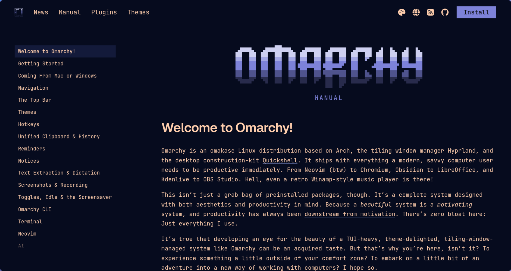

# Launch Omarchy Web Apps Through Firefox

Open Omarchy web apps in Firefox popup windows using your existing Firefox session.
The popup window hides the tab strip, address bar, and sidebar. No Chromium,
separate profile, custom CSS, or Taskbar Tabs registry edits are needed.

Each launch passes the complete URL to Firefox's `windows.create` API. For example,
`https://ntfy.sh/topic-1` and `https://ntfy.sh/topic-2` open their respective paths.
Query strings and fragments are preserved, and repeated launches open new windows.
The website can still redirect after navigation.



*The Omarchy manual running as a Firefox web app. The navigation on the left belongs to the website.*

## Requirements

- Omarchy with its Lua Hyprland configuration
- Native Firefox (this installer does not support Flatpak or Snap), set as the default browser
- Python 3 and the standard Omarchy desktop tools
- The **Omarchy Web Apps** extension installed in the Firefox profile you want to use

Popup windows use that profile's ordinary, non-private cookie store, so existing
logins remain available. Container-specific sessions are not selected. Install the
extension in **one profile only**; the first connected profile owns the bridge.
These are Firefox windows, without separate Taskbar Tabs application identities.

## Install

Install the local launcher and native helper:

```bash
git clone https://github.com/superb-striker/omarchy-firefox-web-apps.git
cd omarchy-firefox-web-apps
./install.sh
```

Then install the signed extension in Firefox:

1. Download the signed [extension `.xpi`][signed-xpi] from [GitHub Releases][releases].
   If clicking prompts Firefox to install it, you can approve that directly or
   right-click the link and choose **Save Link As…** to follow the steps below.
2. If you previously loaded the temporary extension, remove it from
   `about:debugging#/runtime/this-firefox`. Remove the old popup-test add-on too, if present.
3. Open `about:addons`, click the gear icon, and choose **Install Add-on From File…**.
4. Select the downloaded `.xpi` and approve installation of **Omarchy Web Apps**.

The signed extension stays installed across Firefox restarts. You do not need to
load it manually again or submit your own copy to Mozilla for signing.
The `.xpi` and local helper are both required; installing only the extension is not enough.
The installer's final message describes temporary loading; use the signed installation
steps above for everyday use.

Now use **Ctrl+Space → Learn → Omarchy**, or create apps with **Install → Web App**.
Give separate apps distinct names, as Omarchy uses the name for its desktop filename.
**Remove → Web App** uses Omarchy's normal removal menu. Removing a shortcut does not
close an already-open window or erase website data.

### Updates

This extension does not currently configure automatic updates for unlisted releases.
Download a newer signed `.xpi` from [Releases][releases] and install it through
`about:addons` using the same steps. Keep the existing extension installed when
updating a signed version. To update the local helper, pull the repository changes
and rerun `./install.sh`.

### Development: temporary loading

To test changes to the extension source, open `about:debugging#/runtime/this-firefox`,
select **Load Temporary Add-on**, and choose `extension/manifest.json`.
Temporary add-ons disappear when Firefox fully exits; load them again after restarting.
This step is for development and is not needed with the signed release.

Keep the extension ID `webapps@omarchy-firefox-web-apps.local` unchanged: the native
helper authorizes that ID. Modified extension builds need a new Mozilla signature
before permanent installation. See [Mozilla's signing documentation][signing].

## What gets installed

- `~/.local/bin/omarchy-launch-webapp`: sends URLs to the popup bridge when Firefox is default;
  other browsers use Omarchy's original launcher.
- `~/.local/bin/omarchy-webapp-remove`: delegates to Omarchy's original remover,
  replacing the earlier registry-editing override.
- `~/.local/share/omarchy-firefox-web-apps/bridge.py`: Python native host and local client.
- Native-host manifests in `~/.config/mozilla/native-messaging-hosts/` and
  `~/.mozilla/native-messaging-hosts/` for Firefox's modern and legacy locations.
- A managed PATH block in `~/.config/hypr/hyprland.lua` and an environment.d file.

XDG config, data, and state directories are respected. Backups are stored under
`~/.local/state/omarchy-firefox-web-apps`. No files in `/usr/share/omarchy` are changed.
Firefox profile files and Taskbar Tabs registrations are never edited.

## How it works

The extension connects to the native host using Firefox native messaging. The host
listens on a private Unix socket in your runtime directory. The launcher sends the
exact URL; the extension opens a non-private popup and acknowledges success.
The launcher reports an error if Firefox cannot open it. It never retries a URL
after sending it, avoiding duplicate windows when an acknowledgement is lost.

If the bridge is absent, the launcher starts Firefox and waits up to 12 seconds
for the extension. The signed extension connects automatically when its Firefox
profile starts. No background system service is required.

## Verify and troubleshoot

```bash
"${XDG_DATA_HOME:-$HOME/.local/share}/omarchy-firefox-web-apps/bridge.py" --status
~/.local/bin/omarchy-launch-webapp 'https://example.org/first?value=a%2Fb#section'
~/.local/bin/omarchy-launch-webapp 'https://example.org/second'
```

The extension's toolbar tooltip reports connection status. If disconnected, check
that the helper is installed and **Omarchy Web Apps** is enabled in only one profile.
To verify permanent installation, fully quit and reopen Firefox, then launch a web
app from Omarchy. The signed extension should reconnect without temporary loading.

Upgrading from the earlier Taskbar Tabs implementation replaces its launcher and
removal wrapper. Previously generated Firefox shortcuts and registrations remain;
this version does not create any more. Existing Omarchy shortcuts retain their URLs.
A legacy app that exists only as a Firefox-generated shortcut needs to be recreated
through **Install → Web App** to appear in Omarchy's removal menu.

## Uninstall

```bash
./uninstall.sh
```

Then remove the extension in Firefox. The scripts restore backed-up launchers and
native-host files, remove their managed PATH block, and retain backups. If upgrading
from the old implementation, old Taskbar Tabs preferences and registrations are left
alone. Uninstalling does not remove your Omarchy web-app shortcuts or Firefox data.

## Related Omarchy issues and pull requests

This addresses [issue #7034][issue-7034]: web-app launching can fail with Firefox as
the default browser and no Chromium installed, producing the `--app=...` path error.
[Issue #9197][issue-9197] covers the related missing-Chromium error reporting.

Upstream work discussed alongside this project includes [#7039][pr-7039],
[#9206][pr-9206], [#11044][pr-11044], and [#13879][pr-13879]. Those were reported
open during development on October 7, 2026; check their pages for current status.
[#9172][pr-9172] was closed without merging. This project provides a local Firefox
popup integration while that upstream work evolves.

[issue-7034]: https://github.com/omacom/omarchy/issues/7034
[issue-9197]: https://github.com/omacom/omarchy/issues/9197
[pr-7039]: https://github.com/omacom/omarchy/pull/7039
[pr-9172]: https://github.com/omacom/omarchy/pull/9172
[pr-9206]: https://github.com/omacom/omarchy/pull/9206
[pr-11044]: https://github.com/omacom/omarchy/pull/11044
[pr-13879]: https://github.com/omacom/omarchy/pull/13879

[releases]: https://github.com/superb-striker/omarchy-firefox-web-apps/releases/latest
[signing]: https://extensionworkshop.com/documentation/publish/signing-and-distribution-overview/
[signed-xpi]: https://github.com/superb-striker/omarchy-firefox-web-apps/releases/download/v0.2.0/firefox-web-app-extension.xpi
